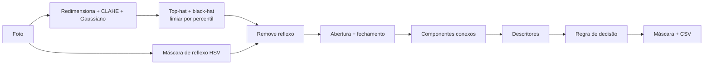

# Proposta Técnica — Vistoria Automática de Veículos (Detecção de Arranhões na Lataria)

> **Revisão M2 (27/10/2026).** Escopo reduzido a arranhões em fotos
> próximas da lataria; dados substituídos por um dataset CC BY 4.0 com
> máscaras de referência; critérios de sucesso e métricas definidos. A
> versão da M1 está no commit `3f42cb6`. Resposta item a item à devolutiva:
> [`relatorio_m2.md`](relatorio_m2.md), seção 2.

## 1. Problema

Locadoras de veículos precisam verificar, no momento da devolução do carro,
se ele retornou com alguma avaria. Essa verificação é feita hoje
majoritariamente de forma manual, o que é lento e sujeito a erro.

O projeto investiga se técnicas clássicas de PDI conseguem **localizar
arranhões em uma foto próxima de um painel da lataria**, sem foto anterior
de referência. A decisão depende de identificar, dentro de uma única
imagem, regiões finas e alongadas cujo contraste, forma e vizinhança são
compatíveis com arranhão — e de distingui-las de estruturas parecidas:
reflexos, vãos entre peças, sujeira e texturas de pneu/asfalto.

**Escopo (M2):**
- um tipo de dano: **arranhão** (riscos na pintura/verniz);
- enquadramento: **close-up de um painel**, a cerca de 0,3–1 m;
- fotos ao ar livre, carros majoritariamente claros (prata, cinza, branco).

Amassados e trincas, presentes na proposta da M1, ficam fora do escopo:
amassado quase não produz borda e exigiria outra abordagem (sombreamento,
estéreo ou antes/depois).

**Situação inicial:** uma foto próxima de um painel no momento da inspeção.

**Informação produzida:** máscara binária das regiões compatíveis com
arranhão e uma tabela de descritores por região (área, alongamento,
contraste, textura do entorno, cor).

## 2. Contexto de aplicação

Apoio à vistoria de devolução em locadoras e à checagem periódica de
frotas: o sistema destaca regiões suspeitas para revisão do funcionário,
sem substituir o julgamento humano. Por isso, nesta fase, **reduzir
alarmes falsos** é tão importante quanto encontrar arranhões: um sistema
que marca tudo não ajuda o vistoriador.

## 3. Objetivos e critérios de sucesso

**Objetivo geral:** dada uma foto próxima da lataria, produzir a máscara
das regiões compatíveis com arranhão e a descrição de cada região.

**Objetivos específicos:**
1. Pipeline executável: realce de estruturas finas → segmentação →
   morfologia → componentes conexos → descritores → regra de decisão.
2. Tratamento explícito dos negativos difíceis: reflexos e junções.
3. Comparação controlada entre o pipeline da M1 (A) e o da M2 (B) em um
   conjunto de teste separado.
4. *(M3)* Classificador supervisionado sobre os descritores e experimento
   antes/depois com captura controlada.

**Critérios de sucesso e métricas** (detalhes em `relatorio_m2.md` §3.6):
- indicadores: precisão, recall e F1 por região (tolerância de 3 px),
  IoU/Dice por pixel e falsos positivos por imagem;
- M2: B reduz FP/imagem em relação a A sem reduzir o F1;
  as regras de reflexo/junção não removem arranhões reais;
- M3: F1 por região acima do baseline A no mesmo conjunto de teste.

## 4. Entrada, saída e pipeline

**Entrada:** foto colorida de um painel (qualquer resolução; o pipeline
reduz para 640 px no maior lado).

**Saída:** máscara binária (PNG), CSV com os descritores de todas as
regiões candidatas (aprovadas ou não, com o motivo) e painel com as
saídas intermediárias.

| Etapa | Finalidade | Técnica | Entrada | Saída |
|---|---|---|---|---|
| Pré-processamento | padronizar escala e contraste | redimensionamento, CLAHE, Gaussiano | foto | cinza suavizado + HSV |
| Realce e segmentação | isolar estruturas mais finas que o elemento estruturante | top-hat + black-hat, limiar por percentil | cinza | máscara binária |
| Reflexo | descartar reflexo especular | limiares em V e S (HSV) | HSV | máscara de reflexo |
| Morfologia | remover ruído e reconectar trechos | abertura, fechamento | máscara | máscara limpa |
| Componentes | separar regiões | rotulação (vizinhança 8) | máscara | regiões rotuladas |
| Representação/descrição | caracterizar cada região | forma, intensidade, textura do entorno, cor | regiões + imagem | tabela de descritores |
| Decisão | transformar região em "arranhão" | regra com limiares por descritor | descritores | máscara final |

A configuração A (baseline da M1: Canny + dilatação + área mínima) é
mantida no mesmo código para comparação. Parâmetros e justificativas em
`relatorio_m2.md` §4–5.

## 5. Imagens e dados

- **Usado na M2:** "Car scratch" v10, PRISMAUTO, Roboflow Universe,
  **CC BY 4.0** —
  <https://universe.roboflow.com/prismauto/car-scratch-pizj9-uu3hr>.
  Subconjunto de **67 fotos** `IMG_5481`–`IMG_5667` (mesma câmera,
  close-ups), com **921 polígonos de arranhão** feitos pelo publicador.
  Divisão: 13 imagens de ajuste e 54 de teste, pela ordem de captura.
  O dataset **não é versionado**; obtenção e preparo em
  `relatorio_m2.md` §3.1 e `scripts/preparar_dados.py`.
- **Descartado:** as 79 imagens restantes do export (origens CarDD, Adobe
  Stock, WhatsApp e desconhecidas) e as imagens do Google Imagens da M1
  (sem licença; removidas do repositório).
- **CarDD:** citado como alternativa; requer formulário de licença e não
  foi usado.
- **M3:** fotos próprias pareadas (antes/depois) com autoria registrada.

Catálogo por imagem (brilho, saturação, reflexo, número e área dos
arranhões, conjunto): `data/catalogo.csv`.

## 6. Arquitetura

- `src/`: pipeline (`pipeline.py`), descritores (`descritores.py`),
  leitura de dados (`data.py`), métricas (`avaliacao.py`), CLI
  (`executar.py`) e painéis (`visualizacao.py`).
- `configs/`: configurações A e B em YAML.
- `scripts/`: preparo dos dados, busca em grade e análise.
- `results/`: saídas versionadas dos experimentos.
- `notebooks/`: demonstração (`02_pipeline_m2.ipynb`) e experimento da M1.
- `tests/`: testes com imagens sintéticas.

## 7. Viabilidade (estado na M2)

O pipeline executa de ponta a ponta. No teste, a configuração B reduziu os
falsos positivos de 8,5 para 1,5 por imagem e dobrou a precisão em relação
à M1, mas o recall caiu de 0,29 para 0,03 (`relatorio_m2.md` §6). A
detecção direta é viável como **filtro de alta precisão**, não ainda como
detector completo. As causas identificadas (fragmentação dos traços,
reflexos de ambiente, marcas de poucos pixels) orientam a M3.

## 8. Referências

Ver `relatorio_m2.md`, seção 11.
