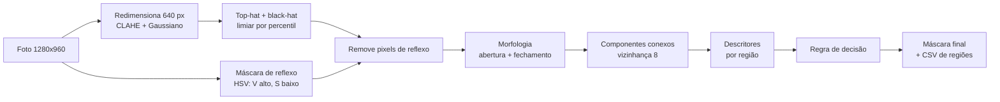
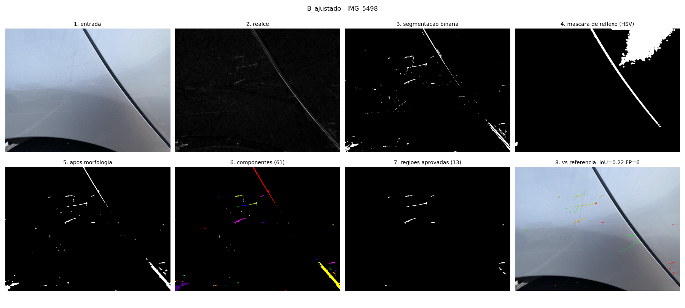
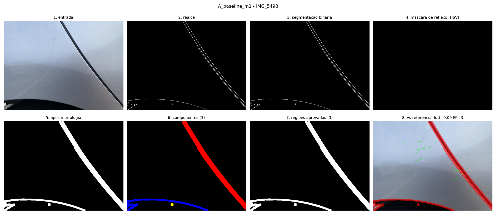
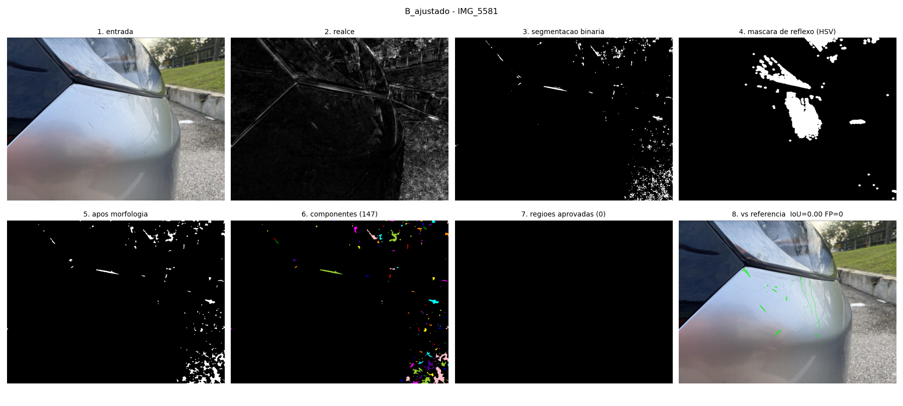
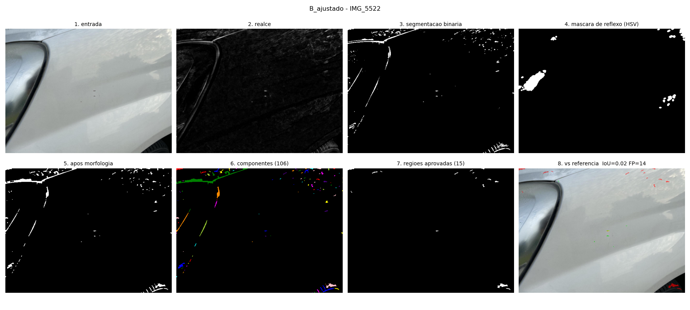

# Relatório parcial — M2

**Projeto:** Vistoria automática de veículos — detecção de arranhões na lataria
**Disciplina:** Processamento de Imagens (PDI), 2026-02 — Projeto Aplicado Longitudinal
**Integrante:** Mateus Rachadel Lohn (trabalho individual)
**Branch / tag de entrega:** `m2` → tag `m2`

---

## 1. Síntese do problema e objetivos atuais

Locadoras precisam verificar, na devolução, se o carro voltou com avarias. O
projeto investiga se técnicas clássicas de PDI conseguem **localizar
arranhões em uma foto próxima da lataria**, produzindo uma máscara das
regiões suspeitas para revisão humana.

Na M1 o escopo era amplo (risco, amassado e trinca em fotos de qualquer
enquadramento) e não havia referência para medir acerto. Na M2 o escopo foi
**reduzido**, conforme a devolutiva:

| Aspecto | M1 | M2 |
|---|---|---|
| Tipo de dano | risco, amassado, trinca | **somente arranhão** |
| Enquadramento | foto qualquer do veículo | **close-up de um painel** (≈ 0,3–1 m) |
| Dados | imagens do Google Imagens, sem licença | **67 fotos CC BY 4.0** com polígonos de referência |
| Saída | bounding boxes sem verificação | **máscara de arranhões + tabela de descritores por região** |
| Avaliação | inspeção visual | **IoU/Dice por pixel e precisão/recall/F1 por região** |

**Objetivo geral (atualizado):** dada uma foto próxima da lataria, produzir
uma máscara binária das regiões compatíveis com arranhão e a descrição de
cada região (forma, contraste, textura, cor).

**Objetivos específicos:**
1. Implementar um pipeline executável: realce de estruturas finas →
   segmentação → morfologia → componentes conexos → descritores → regra de
   decisão.
2. Tratar explicitamente os negativos difíceis apontados na devolutiva:
   reflexos e junções entre peças.
3. Comparar o pipeline da M1 (A) com o pipeline da M2 (B) em um conjunto de
   teste separado, com indicadores quantitativos.

**Critérios de sucesso definidos antes do teste:**
- *Principal:* B reduz os falsos positivos por imagem em relação a A sem
  reduzir o F1 por região.
- *Secundário:* as regras de reflexo e de junção removem regiões falsas sem
  remover arranhões reais.

Resultado (seção 6): o critério secundário foi atingido; o principal
**não** — B reduziu os falsos positivos em 82 %, mas o F1 caiu de 0,114 para
0,050 por perda de recall. A análise das causas orienta a M3.

## 2. Resposta à devolutiva e evolução desde a M1

### 2.1 Ações para cada correção essencial

| # | Orientação da devolutiva | Ação tomada | Evidência |
|---|---|---|---|
| 1 | Retirar imagens sem licença; usar CarDD ou fotos próprias | Imagens do Google removidas do repositório. O CarDD exige pedido de licença por formulário (prazo incompatível); adotado o dataset **Car scratch v10 (Roboflow Universe, CC BY 4.0)**, filtrado para as 67 fotos de origem coerente (seção 3). | `scripts/preparar_dados.py`, `data/catalogo.csv`, commit `5fc13ee` (remoção de `images/`) |
| 2 | Reduzir a um tipo de dano e a fotos próximas de uma região da lataria | Escopo reduzido a arranhão em close-ups. Parte das fotos ainda mostra pneu/roda/asfalto no quadro; tratado pela regra "entorno texturizado" e registrado como limitação. | seção 1; `configs/B_ajustado.yaml` |
| 3 | Obter bounding boxes/máscaras de referência | Usados os 921 polígonos de arranhão do próprio dataset (anotação de terceiros). | `data/car_scratch/_annotations.coco.json` (gerado) |
| 4 | Comparar com a referência e analisar reflexos/junções como negativos difíceis | Métricas IoU/Dice e precisão/recall; máscara de reflexo HSV e regra de junção, com contagem de quantas regiões cada regra removeu e quantas eram arranhão real. | `results/teste/analise.md` §3 |
| 5 | Avaliar se antes/depois controlado é mais verificável que detecção direta | **Não foi feito experimento** (sem fotos próprias pareadas no prazo). Os resultados da M2 reforçam o argumento a favor do antes/depois (seção 7); um experimento controlado está planejado para a M3. | seção 8 |

### 2.2 O que foi mantido, corrigido ou substituído

| Item | Situação | Justificativa |
|---|---|---|
| Problema e contexto (locadoras) | mantido | continua pertinente |
| Detecção direta em foto única | mantida, com escopo reduzido | permite avaliar com a referência disponível; antes/depois exige pares de fotos que o dataset não tem |
| Canny + dilatação + área (M1) | mantido como **baseline A** | serve de referência para medir a evolução |
| Realce por Canny | substituído por **top-hat + black-hat** na config B | Canny responde a qualquer borda (pneu, vão de porta); top-hat responde só a estruturas mais finas que o elemento estruturante |
| Classificação heurística arranhão × amassado | removida | escopo reduzido a um tipo de dano |
| Filtro só por área | substituído por **regra com descritores** | a M1 já indicava que área sozinha não separa dano de reflexo |
| Imagens do Google Imagens | removidas | sem licença nem proveniência |

## 3. Dados e protocolo experimental

### 3.1 Origem e licença

- **Dataset:** "Car scratch", autor PRISMAUTO, Roboflow Universe —
  <https://universe.roboflow.com/prismauto/car-scratch-pizj9-uu3hr> —
  **versão 10**, licença **CC BY 4.0**, exportado em "COCO Segmentation" em
  27/10/2026.
- **Por que a v10:** é a versão sem *augmentation* e colorida. A v14 tem 3
  cópias aumentadas de cada foto (rotação, cisalhamento, ruído sal e
  pimenta), o que distorceria a avaliação; a v9 está em escala de cinza com
  equalização já aplicada, o que impede a máscara de reflexo em HSV.
- **Não versionado.** O repositório guarda apenas o catálogo e o split. Para
  obter: criar conta gratuita na Roboflow, abrir a página acima → aba
  *Dataset* → v10 → *Download Dataset* → formato **COCO Segmentation** →
  *Download zip to computer*; extrair em `data/raw/car_scratch_v10/` e rodar
  `python scripts/preparar_dados.py`.

### 3.2 Seleção

O export tem 146 imagens de origens misturadas. Pelos nomes de arquivo:

| Grupo | Qtd | Origem provável | Decisão |
|---|---:|---|---|
| `IMG_5481` … `IMG_5667` | 67 | mesma câmera, numeração sequencial, close-ups | **usado** |
| `000020`, `001052`, … | 43 | padrão de nomes do CarDD (licença restrita) | descartado |
| `240_F_…`, `adobestock…` | ≈ 10 | Adobe Stock (comercial) | descartado |
| WhatsApp, Reddit, Flickr, outros | ≈ 26 | desconhecida | descartado |

A declaração CC BY 4.0 é do publicador do dataset; manter só o grupo com
origem coerente evita repetir o problema de licença apontado na M1.

### 3.3 Características

Todas as 67 imagens são fotos próximas da lataria, ao ar livre, de carros
majoritariamente prata/cinza/branco (saturação média mediana 21–28 em 0–255).
Após o recorte das faixas pretas do resize da Roboflow ficam com 1280 × 960 px;
o pipeline as reduz a 640 × 480.

| Conjunto | Imagens | Arranhões anotados | dos quais `tiny-scratch` | Arranhões/imagem (mediana, mín–máx) | % da imagem anotada (mediana, máx) | Imagens com > 1 % de reflexo especular |
|---|---:|---:|---:|---|---|---:|
| ajuste | 13 | 178 | 122 | 8 (1–76) | 0,17 % (0,94 %) | 12 |
| teste | 54 | 743 | 358 | 7,5 (1–64) | 0,20 % (3,48 %) | 40 |

Situações difíceis presentes: reflexos de céu e árvores na pintura (ex.
`IMG_5522`), para-choques curvos (`IMG_5581`), pneu e asfalto no quadro
(`IMG_5483`), vãos entre portas (`IMG_5498`) e arranhões de poucos pixels
(`tiny-scratch`, metade das anotações). O catálogo completo, com brilho,
saturação, fração de reflexo e área anotada por imagem, está em
`data/catalogo.csv`.

### 3.4 Referência

A referência são os polígonos do próprio dataset, feitos pelo publicador
(terceiro). As classes `scratch` e `tiny-scratch` foram unidas em
"arranhão", mas o tipo original é preservado para a análise de recall por
tipo. **Limites:** não há documentação do critério de anotação; os polígonos
de `tiny-scratch` cobrem marcas de poucos pixels, difíceis até para
inspeção humana; e conferi visualmente apenas algumas imagens.

### 3.5 Divisão ajuste × teste

O método não tem treinamento, mas tem parâmetros. A divisão segue a **ordem
de captura** (número do arquivo), porque fotos consecutivas tendem a ser do
mesmo carro:

- **ajuste:** `IMG_5481`–`IMG_5493` (13 imagens) — usado para escolher
  parâmetros;
- **teste:** `IMG_5498`–`IMG_5667` (54 imagens) — usado **uma única vez**
  para a avaliação final.

A fronteira foi colocada no maior salto de numeração do início da sequência
(5493 → 5498). Lista exata em `data/split.csv`.

### 3.6 Indicadores

Definidos em `src/avaliacao.py`, calculados na escala de 640 px:

- **IoU** = |P ∩ R| / |P ∪ R| e **Dice** = 2|P ∩ R| / (|P| + |R|), por
  imagem, com média nas imagens.
- **Recall por região:** um arranhão de referência conta como *detectado* se
  ≥ 30 % dos seus pixels estão cobertos pela predição dilatada em 3 px.
- **Precisão por região:** uma região predita é *verdadeiro positivo* se
  ≥ 50 % dos seus pixels caem sobre a referência dilatada em 3 px; caso
  contrário, *falso positivo* (FP).
- **F1** = 2PR / (P + R) e **FP por imagem**.

A tolerância de 3 px existe porque os arranhões têm 1–5 px de largura; um
deslocamento de 1 px no contorno zeraria o IoU de uma marca correta. O IoU
por pixel é muito sensível a isso, por isso o F1 por região é o critério
principal.

## 4. Pipeline implementado



| Etapa | Arquivo / função | Finalidade | Entrada → saída | Parâmetros (B ajustada) |
|---|---|---|---|---|
| Redimensionamento | `pipeline.redimensionar` | padroniza a escala para que kernels e áreas em px signifiquem o mesmo em todas as fotos | BGR → BGR com maior lado 640 | `lado_max: 640` |
| Pré-processamento | `pipeline.preprocessar` | CLAHE equaliza contraste localmente (iluminação desigual); Gaussiano reduz ruído do sensor | BGR → cinza suavizado + HSV | `clahe: true` (clip 2, grade 8 × 8), `blur_ksize: 3` |
| Realce | `pipeline.realce_tophat` | black-hat (fechamento − imagem) realça traços finos escuros; top-hat (imagem − abertura) realça traços claros; usa-se o máximo | cinza → mapa de resposta 0–255 | `tophat_kernel: 9` (elipse) |
| Segmentação | idem | mantém os pixels de maior resposta | resposta → binária | `limiar: p98` (2 % mais fortes) |
| Máscara de reflexo | `pipeline.mascara_reflexo` | reflexo especular é muito claro e pouco saturado; esses pixels são zerados antes da morfologia | HSV → máscara binária | `v_min: 230`, `s_max: 40`, dilatação 7 |
| Morfologia | `pipeline.aplicar_morfologia` | abertura 2 × 2 remove pontos isolados; fechamento tenta reconectar trechos do mesmo risco | binária → binária | abrir 2 (quadrado), fechar 5 (elipse) |
| Componentes conexos | `skimage.measure.label` | separa cada região candidata | binária → rótulos | conectividade 8 |
| Descritores | `descritores.extrair_descritores` | descreve cada região (tabela 4.1) | rótulos + cinza + HSV → dicionário por região | anel de 5 px para o entorno |
| Regra de decisão | `pipeline.regiao_aprovada` | regra verificável que transforma região em "arranhão" | descritores → aprovada/motivo | tabela 4.2 |
| Avaliação | `avaliacao.avaliar_imagem` | compara com a referência | máscara + polígonos → métricas | tolerância 3 px |

### 4.1 Descritores (representação e descrição)

Unidades em pixels da imagem de 640 px. Cálculo em `src/descritores.py`
(scikit-image `regionprops` + cálculos próprios).

| Atributo | Unidade | Cálculo |
|---|---|---|
| `area_px` | px² | número de pixels da região |
| `area_frac` | — | área / área da imagem |
| `perimetro_px` | px | perímetro do contorno (vizinhança 8) |
| `eixo_maior_px`, `eixo_menor_px` | px | eixos da elipse com os mesmos momentos de 2ª ordem |
| `alongamento` | — | eixo maior / max(eixo menor, 1) |
| `excentricidade` | — | da mesma elipse (0 = círculo, → 1 = linha) |
| `solidez` | — | área / área do fecho convexo |
| `circularidade` | — | 4π·área / perímetro² |
| `orientacao_graus` | graus | ângulo do eixo maior |
| `comprimento_frac` | — | eixo maior / diagonal da imagem |
| `intensidade_media` | 0–255 | média do cinza na região |
| `contraste_local` | 0–255 | \|média na região − média no anel de 5 px\| |
| `textura_entorno` | 0–255 | desvio-padrão do cinza no anel de 5 px |
| `saturacao_media` | 0–255 | média do canal S (HSV) na região |
| `frac_reflexo` | — | fração da região dentro da máscara de reflexo |
| `toca_borda` | bool | bounding box encosta na borda da imagem |

Observação: em regiões de poucos pixels a circularidade passa de 1, porque o
perímetro discreto é subestimado; por isso ela não é usada na regra.

### 4.2 Regra de decisão (B ajustada)

Uma região é aprovada como arranhão se passar em todos os critérios:

| Critério | Rejeita se | Motivo físico |
|---|---|---|
| área mínima | `area_px < 15` | fragmentos de ruído/textura |
| área máxima | `area_frac > 0,05` | arranhão é fino; regiões grandes são peças/sombras |
| alongamento | `alongamento < 2,5` | arranhões são alongados |
| reflexo | `frac_reflexo > 0,3` | região dentro de reflexo especular |
| entorno texturizado | `textura_entorno > 20` | pneu, roda e asfalto têm vizinhança texturizada; a pintura é lisa |
| junção de peças | `toca_borda` e `comprimento_frac > 0,15` | vãos entre portas/painéis atravessam a foto |

### 4.3 O que funciona e o que está pendente

| Funciona (executável e testado) | Pendente |
|---|---|
| fluxo completo da imagem até a máscara, o CSV de regiões e as métricas | classificador supervisionado sobre os descritores (M3) |
| configurações declarativas em YAML (A e B) | correção do fechamento para traços de 1 px (seção 7) |
| busca em grade só no ajuste | experimento antes/depois com fotos próprias (M3) |
| análise por tipo de anotação e por regra | saída em bounding boxes para o usuário final |
| painéis com as saídas intermediárias | |

## 5. Fundamentação das escolhas

- **Top-hat/black-hat em vez de Canny.** Canny marca toda transição de
  intensidade: contorno do pneu, vão de porta, borda de reflexo. O top-hat
  morfológico só responde a estruturas **mais estreitas que o elemento
  estruturante**, que é exatamente a característica geométrica de um
  arranhão. Usar o máximo de top-hat e black-hat cobre os arranhões claros
  (verniz removido) e os escuros (sulco).
- **Limiar por percentil em vez de Otsu.** Os arranhões ocupam 0,2 % da
  imagem (mediana). Com histograma quase todo de fundo, o Otsu escolhe um
  limiar baixo e devolve a textura inteira (observado no primeiro teste no
  ajuste: 10,5 FP/imagem). O percentil fixa a fração de pixels mantidos.
- **Máscara de reflexo em HSV.** Reflexo especular satura o canal V e tem S
  baixo, independentemente da cor do carro, enquanto o arranhão altera pouco
  o V.
- **Descritores e regra.** Na análise das regiões candidatas do ajuste, os
  arranhões reais são maiores e ficam sobre entorno mais liso e menos
  saturado que os candidatos falsos (tabela abaixo, gerada de
  `results/ajuste_B/execucao/descritores.csv`, regiões com área ≥ 15 px²).
  A sobreposição é grande, o que já indicava o limite de uma regra fixa.

| Descritor | Reais (n = 14): mediana (Q1–Q3) | Falsas (n = 279): mediana (Q1–Q3) |
|---|---|---|
| `area_px` | 87,5 (26,8–173,8) | 39,0 (23,0–109,0) |
| `alongamento` | 3,0 (2,5–6,3) | 3,1 (1,9–5,6) |
| `textura_entorno` | 17,8 (12,6–19,6) | 23,8 (11,3–42,4) |
| `saturacao_media` | 10,8 (4,0–22,5) | 24,9 (11,2–40,7) |
| `contraste_local` | 30,6 (11,9–33,5) | 20,7 (10,8–40,9) |

- **Busca em grade.** Os parâmetros de B foram escolhidos por
  `scripts/ajustar_parametros.py`: 27 combinações de segmentação (kernel do
  top-hat ∈ {9, 15, 21}, percentil ∈ {96, 98, 99}, fechamento ∈ {3, 5, 7})
  × 48 de regra (área mínima ∈ {15, 30, 60}, alongamento ∈ {1,5; 2,5},
  textura máxima ∈ {15, 20, 30, sem}, junção ∈ {0,15; 0,30}) = 1296
  configurações, avaliadas **só nas 13 imagens de ajuste**, escolhendo pelo
  maior F1. Tabela completa em `results/ajuste_B/grade.csv`.

## 6. Experimento E1 — baseline da M1 (A) × pipeline da M2 (B)

### 6.1 Pergunta e configuração

**Pergunta:** o realce de estruturas finas, a remoção de reflexos e a regra
por descritores reduzem os falsos positivos do pipeline da M1 sem perder
arranhões reais?

| | A — baseline M1 (`configs/A_baseline_m1.yaml`) | B — proposta M2 (`configs/B_ajustado.yaml`) |
|---|---|---|
| Realce | Canny (50, 150) sobre Gaussiano 5 × 5 | top-hat + black-hat (elipse 9), CLAHE, Gaussiano 3 × 3 |
| Segmentação | bordas do Canny | percentil 98 |
| Reflexo | — | máscara HSV (V ≥ 230, S ≤ 40) |
| Morfologia | dilatação 5 × 5, 2 iterações | abertura 2 + fechamento 5 |
| Regra | área ≥ 150 px² | tabela 4.2 |

**Mantido constante:** as mesmas 54 imagens de teste, a mesma escala
(640 px), a mesma referência e as mesmas métricas e tolerâncias.
**Mudou:** apenas o pipeline. A única diferença de A em relação ao notebook
da M1 é o redimensionamento para 640 px, aplicado igualmente às duas.

### 6.2 Execução

```bash
python -m src.executar --config configs/A_baseline_m1.yaml --dados data/car_scratch --conjunto teste --saida results/teste/A_baseline_m1
python -m src.executar --config configs/B_ajustado.yaml   --dados data/car_scratch --conjunto teste --saida results/teste/B_ajustado
python scripts/analisar_resultados.py
```

Saídas: `results/teste/<config>/` (métricas por imagem, descritores de
todas as regiões candidatas, máscaras preditas, resumo) e
`results/teste/analise.md`.

### 6.3 Resultados (teste, 54 imagens, 743 arranhões)

| Config | Precisão | Recall | F1 | IoU médio | Dice médio | Regiões preditas | FP/imagem |
|---|---:|---:|---:|---:|---:|---:|---:|
| A — M1 | 0,071 | **0,287** | **0,114** | 0,011 | 0,022 | 494 | 8,50 |
| B — M2 | **0,170** | 0,030 | 0,050 | **0,017** | **0,027** | 100 | **1,54** |

No ajuste (13 imagens), B tinha IoU médio 0,097 e A 0,006. A queda do IoU
de B no teste (0,097 → 0,017) mostra que os parâmetros escolhidos em 13
imagens **não generalizam bem**, efeito esperado de um conjunto de ajuste
pequeno.

**Recall por tipo de anotação:**

| Config | `scratch` | `tiny-scratch` |
|---|---:|---:|
| A | 132/385 = 0,343 | 81/357 = 0,227 |
| B | 21/385 = 0,055 | 1/357 = 0,003 |

**Custo de cada regra em B** (regiões candidatas rejeitadas e quantas
estavam sobre arranhão real):

| Motivo | Regiões | Sobre arranhão real |
|---|---:|---:|
| área pequena | 3732 | 85 (2,3 %) |
| entorno texturizado | 877 | 14 (1,6 %) |
| pouco alongada | 818 | 16 (2,0 %) |
| reflexo | 24 | **0** |
| junção de peças | 6 | **0** |
| *aprovadas* | *100* | *17 (17 %)* |

### 6.4 Interpretação

1. **B reduz muito os falsos positivos** (8,5 → 1,5 por imagem) e dobra a
   precisão. As regras de **reflexo e junção** removeram 30 regiões sem
   perder nenhum arranhão — o critério secundário foi atingido e os
   negativos difíceis da devolutiva foram tratados com evidência.
2. **B perde quase todo o recall.** A maior perda acontece **antes** da
   regra: o limiar por percentil fragmenta cada arranhão em pedaços de
   poucos pixels (3732 fragmentos rejeitados por área), e o fechamento com
   elipse 5 × 5 não reconecta traços de 1 px — o elemento elíptico do OpenCV
   tem só um pixel nas linhas extremas, o que foi confirmado ao escrever
   `tests/test_pipeline.py::test_fechamento_reconecta_risco_fragmentado`
   (o teste só passa com kernel quadrado).
3. **O recall de A é em parte artificial.** A dilatação 5 × 5 × 2 gera
   manchas largas que "cobrem" arranhões pequenos vizinhos por acaso (ex.
   pneu e textura junto a um arranhão, `IMG_5483`, do conjunto de ajuste); o IoU de A (0,011)
   mostra que ela marca a área, não o arranhão. Onde os arranhões estão em
   pintura lisa e longe de outras bordas, A tende a não vê-los (Figura 2).
4. **`tiny-scratch` está fora do alcance** de ambas as configurações com
   regras fixas: são marcas de 2–10 px de comprimento em 640 px.
5. **Resposta à pergunta:** sim para os falsos positivos, **não** para
   "sem perder arranhões". A regra fixa troca recall por precisão; a
   sobreposição dos descritores (seção 5) indica que um limiar fixo por
   atributo não separa bem as classes.

### 6.5 Casos de sucesso e de falha

Painéis em `results/casos/<config>/figuras/`. Cada painel mostra: 1) entrada,
2) realce, 3) segmentação binária, 4) máscara de reflexo, 5) após
morfologia, 6) componentes rotulados, 7) regiões aprovadas, 8) comparação
com a referência (verde = referência, vermelho = predição, amarelo =
acerto).

**Sucesso — `IMG_5498` (B: 7/15 arranhões, IoU 0,22).**



*Figura 1 — Painel lateral prata com arranhões finos sobre pintura lisa. O
top-hat destaca os riscos (2) e a máscara de reflexo cobre a borda
iluminada do vão da porta (4), que por isso não vira falso positivo. Os
arranhões mais longos são aprovados (7, 8); os mais curtos se fragmentam e
caem no filtro de área.*

**Comparação com A na mesma imagem:**



*Figura 2 — Na mesma foto, A não detecta nenhum arranhão (IoU 0,00): com
limiares 50/150 o Canny não responde às marcas sutis (2), e as únicas
regiões aprovadas são o vão da porta e a borda da caixa de roda, ambas
falsos positivos (3 FP). É o comportamento "bordas não são detecção"
apontado na devolutiva.*

**Falha 1 — `IMG_5581` (B: 0/25 arranhões, 0 FP).**



*Figura 3 — Para-choque curvo e muito reflexivo, com grama e asfalto no
quadro. Nenhuma região candidata coincide com a referência (verde em 8): a
falha é da **segmentação**, não da regra. Os arranhões são mais sutis que as
variações de reflexo da superfície curva, e o asfalto gera a maior parte da
resposta do top-hat (canto inferior direito em 3).*

**Falha 2 — `IMG_5522` (B: 14 FP).**



*Figura 4 — Pintura brilhante refletindo céu e galhos. As bordas desses
reflexos são finas, alongadas e estão sobre entorno liso — passam em todos
os critérios da regra. Como são reflexos coloridos/acinzentados (não
brancos), a máscara HSV (4) não os pega. É o negativo difícil que uma regra
fixa de forma e cor não resolve.*

## 7. Falhas, limitações e riscos

| Limitação | Impacto | Encaminhamento |
|---|---|---|
| Fechamento com elipse 5 × 5 não reconecta traços de 1 px | fragmenta arranhões → baixa de recall | M3: testar kernel quadrado/linear orientado, ajustando só no conjunto de ajuste |
| Ajuste em 13 imagens | parâmetros não generalizam (IoU 0,097 → 0,017) | M3: validação cruzada por blocos de captura |
| Reflexos de ambiente (céu, árvores) | principal fonte de FP restante | M3: descritores de textura/cor mais ricos + classificador |
| `tiny-scratch` | quase não detectável com PDI clássico nesta resolução | M3: avaliar em resolução maior e reportar separadamente |
| Referência de terceiros sem critério documentado | métricas dependem da anotação | conferir uma amostra visualmente e registrar divergências |
| Carros majoritariamente prata/cinza | pode não valer para cores escuras/saturadas | declarado como escopo; ampliar na M3 se houver dados com licença |
| Pneu e asfalto no quadro | geram candidatos falsos | regra de entorno ajuda; recorte manual da região da lataria é alternativa |
| Licença declarada pelo publicador | risco residual sobre a origem real das fotos `IMG_` | documentado; dataset não versionado |

**Detecção direta × antes/depois (item 5 da devolutiva).** Os resultados
apoiam a suspeita do professor: em foto única, reflexos e texturas produzem
regiões indistinguíveis de arranhões por forma e cor (Figura 4). Com uma
foto de referência do mesmo painel, alinhada, essas estruturas se repetem
nas duas fotos e se cancelam na diferença, sobrando só o que mudou. O custo
é exigir captura controlada (mesma posição e iluminação). Isso é
investigado na M3.

## 8. Plano para a M3

| # | Tarefa | Responsável | Evidência esperada |
|---|---|---|---|
| 1 | Corrigir o fechamento (kernel quadrado/linear) e reavaliar só no ajuste | Mateus | nova linha na grade; teste unitário com elipse |
| 2 | Validação por blocos de captura (k = 4) para escolher parâmetros com mais imagens | Mateus | `results/cv/`, média ± desvio do F1 |
| 3 | Classificador (scikit-learn, árvore/random forest) sobre os descritores das regiões, rótulo = pureza ≥ 0,5 | Mateus | comparação A × B × B+classificador no teste |
| 4 | Experimento antes/depois controlado com fotos próprias (painel limpo × risco removível simulado), alinhamento ORB + homografia, diferença | Mateus | 10–20 pares próprios com autoria registrada; IoU com marcação manual |
| 5 | Saída final com bounding boxes por região aprovada | Mateus | figura de demonstração |
| 6 | Relatório final, vídeo da M3 e tag `m3` | Mateus | `docs/relatorio_m3.md`, link no README |

## 9. Processo e contribuições

Trabalho **individual**: implementação, dados, experimentos, análise e
documentação são de Mateus Rachadel Lohn, com apoio de IA declarado na
seção 11.

O desenvolvimento da M2 foi concentrado em 27/10/2026, na branch `m2`, com
um commit por etapa (pipeline → dados → ajuste → experimento → testes →
documentação). As decisões do dia estão em [`diario_m2.md`](diario_m2.md).

## 10. Como reproduzir

```bash
pip install -r requirements.txt
python -m pytest tests                      # 6 testes, sem dataset
# obter o dataset (seção 3.1) e extrair em data/raw/car_scratch_v10/
python scripts/preparar_dados.py
python scripts/ajustar_parametros.py         # opcional: refaz a busca em grade (~10 min)
python -m src.executar --config configs/B_ajustado.yaml --dados data/car_scratch \
    --conjunto teste --saida results/teste/B_ajustado
```

Demonstração passo a passo: `notebooks/02_pipeline_m2.ipynb`.

## 11. Referências

- PRISMAUTO. *Car scratch Dataset*, v10. Roboflow Universe, 2025. CC BY 4.0.
  <https://universe.roboflow.com/prismauto/car-scratch-pizj9-uu3hr>.
- WANG, X. et al. CarDD: A New Dataset for Vision-Based Car Damage
  Detection. *IEEE Transactions on Intelligent Transportation Systems*,
  2023. (citado como alternativa não utilizada)
- GONZALEZ, R. C.; WOODS, R. E. *Digital Image Processing*. 4. ed.
  Pearson, 2018 — morfologia (top-hat, abertura, fechamento), limiarização
  e representação de regiões.
- SOILLE, P. *Morphological Image Analysis*. 2. ed. Springer, 2003 —
  transformadas top-hat.
- CANNY, J. A Computational Approach to Edge Detection. *IEEE TPAMI*, v. 8,
  n. 6, 1986.
- OTSU, N. A Threshold Selection Method from Gray-Level Histograms. *IEEE
  TSMC*, v. 9, n. 1, 1979.
- ZUIDERVELD, K. Contrast Limited Adaptive Histogram Equalization. In:
  *Graphics Gems IV*, 1994.
- Documentação: OpenCV 5.0 (morphologyEx, Canny, CLAHE), scikit-image 0.26
  (`measure.label`, `measure.regionprops`).

## 12. Declaração de uso de IA generativa

| Ferramenta | Finalidade | Materiais | Verificação |
|---|---|---|---|
| Claude Code (Anthropic, modelo Claude Opus 5.5) | planejamento da M2 a partir do enunciado e da devolutiva; busca e conferência do dataset; escrita do código (`src/`, `scripts/`, `tests/`); execução dos experimentos; redação deste relatório, do README, do diário e do roteiro do vídeo | todos os arquivos criados/alterados na branch `m2` | testes automatizados (`pytest`), execução real dos comandos da seção 10, inspeção visual dos painéis, revisão e aprovação de cada etapa e commit por mim |
| (M1) ferramenta de IA generativa | estruturação da documentação e organização do repositório | `README.md`, `docs/proposta.md` da M1 | revisão própria |

Respondo pelo conteúdo entregue e sou capaz de explicar cada operação
utilizada.
